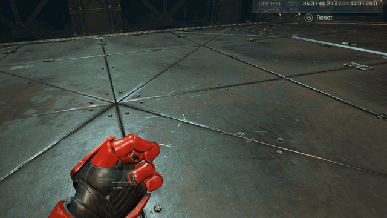
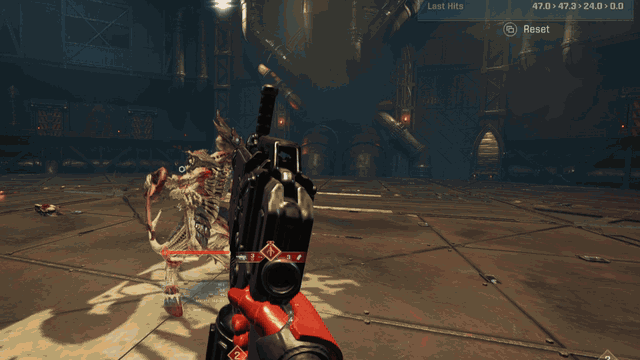

# Space Marine 2 VR

A rough alpha release of a PC VR mod for Warhammer 40,000: Space Marine 2. First person motion
controls have been implemented for most functionality. Guns aim where you point them, swords
can be swung, and most of the game kinda works. A second mode, the chase camera, puts the game's
own over-the-shoulder camera in the headset and you play it with a gamepad.

> **Feedback and help welcome.** If you give it a go,
> [tell me what worked and what didn't](https://github.com/Joe975/space-marine-2-vr/issues).
> Bug reports, testing on other headsets, fixes and features all help.
> See [Contributing](CONTRIBUTING.md) for ways to help.

*Motion tracking works, but there are some bugs...*

**Unofficial, non-commercial fan mod. Not affiliated with or endorsed by Saber Interactive, Focus
Entertainment or Games Workshop.** The game itself is [on Steam](https://store.steampowered.com/app/2183900/).
This repo and the release zip only carry the mod's own code; none of the game's code or data is
distributed. The game data the mod needs is built on your PC from your own copy of the game.

<!-- media: hero reel (GIF or video loop, 5-10 s: look around a vista, draw, fire, swing) -->

## Controls - 1st Person

For **Valve Index controllers**. Left/right below mean your physical hands. Tap acts when you
release the button; a one-second hold does its own action. Quest and Rift S Touch controllers
have no trackpads, so a few controls move, including recenter (X and Y held together):
[Touch controllers](docs/CONTROLS.md#touch-controllers-quest-rift-s). Not yet played on Touch.
The third-person views use a gamepad instead: [Controls - 3rd person](#controls---3rd-person).

### In game

| Action | Control |
|---|---|
| Move / sprint / turn | Left stick to walk; click it to toggle sprint. Right stick left/right to snap turn. |
| Dodge / finisher | Right A to dodge in your movement direction. Right stick click for a finisher. |
| Shoot / aim | Primary: right trigger fires, left trigger puts you into ADS mode. Pistol: left trigger fires; right trigger revs the chainsword. Two-handed weapon holding isn't working well yet. |
| Swap weapons | Right grip at your right hip swaps between the bolter / primary and the pistol. Left trackpad down also switches weapons. |
| Melee | Swing your right hand. Trigger released = light attack; trigger held = power attack. Move your arm, not just your wrist. The melee still needs tuning. |
| Parry / block | Left grip away from the belt and gun, or raise your left forearm across your face. An attack drops the guard; lower it or release and squeeze again. Parry is sadly inconsistent at the moment. |
| Shove enemies back | With the sword out, thrust an open hand forwards from your chest. A fist or squeezed grip won't trigger it. |
| Reload / interact | Tap right B to reload; hold it to use a pickup, console or armoury. Look at what you want to use, shove your hand inside it for good measure. |
| Grenade / melta detonation | Left grip at your belt, then throw and release. Right trackpad press also uses equipment. Hold the right stick click to detonate a placed melta charge. |
| Stim / class ability | Left trackpad right for a stim. Tap left A for your ability; hold left trackpad up for abilities that need aiming or charging. |
| Pause / camera mode / recenter | Tap left B to pause; hold it one second for camera mode. Hold left A one second to recenter, standing straight. |

Move / sprint / turn: armour clipping

<!-- media: movement and turning showing the remaining armour clipping -->

<em>The armour clipping isn't entirely solved.</em>

Execution + camera mode

<em>You watch finishers from where you triggered them.</em>

Grenade / melta detonation

<!-- media: small GIF of placing and detonating a melta charge -->

Stim / class ability

<!-- media: small GIF of triggering a class ability with left A -->

Every binding is in [Controls](docs/CONTROLS.md).

### Camera mode

Hold left B for one second to enter camera mode and pause the game.

| Action | Control |
|---|---|
| Fly horizontally | Left stick, relative to where you look. |
| Turn / fly up or down | Right stick left/right to snap turn; up/down to fly vertically. |
| Drag the world | Hold one grip and move that hand. |
| Scale and turn the world | Hold both grips and move your hands. Hands apart makes the world bigger. |
| Jump to a preset scale | Right trigger: life size, 1:12 action figure, then the world four times bigger. |
| Return to the game | Tap left B. |

<!-- media: camera mode flying around a frozen battle, then scaling it to tabletop size -->

*Change scale to see your battle as if on a tabletop (much cooler viewed in-VR).*

### Menus

| Action | Control |
|---|---|
| Navigate | Either stick, trackpads or triggers; snap turn and gameplay gestures are off. |
| Confirm / back | Right A confirms; right B goes back or closes pause. |
| Other prompts / tabs | Left A = the game's X; tap left B = Y. Left/right grips = LB/RB for tabs. |

### Classes

These have each had basic testing and have varying levels of jank in how their specials work.

| Class | Ability and controls to know |
|---|---|
| Tactical | Auspex Scan: look at the target, hold left trackpad up to aim, release to scan. Left A gives a quick cast, but it's tricky to guess exactly where the centre aim goes. |
| Assault | Tap left A to dash. Hold left trackpad up briefly to leap with the jump pack, look at the landing marker, then swing in the air to slam down. This feels decent but aiming could be easier. |
| Vanguard | Grapnel Launcher: look at an enemy, hold left trackpad up to aim, release to grapple. Left A gives a quick cast. |
| Bulwark | Tap left A to plant the Chapter Banner. Hold left grip to raise the shield; release and squeeze again after an attack. Shield Bash/Riposte aren't supported by the current gesture mapping. |
| Sniper | Tap left A for Camo Cloak. With the rifle out, left trigger aims and right trigger fires; the rifle stays in your right hand. Have not worked out scoping yet. |
| Heavy | Tap left A for Iron Halo. Left trigger puts you into aim mode. Two-handed heavy weapon grip is unreliable. |
| Techmarine | Tap left A to place the turret. Targeting and other class-specific actions are untested in VR. |

The [full controls](docs/CONTROLS.md) cover gestures, keyboard shortcuts and gamepad views.

## What you can do

- **Swing the sword for real.** Your arm has to move; a wrist flick does nothing. Trigger off is a
  light attack, trigger held is a power attack, and slashes chain into each other.
  <!-- media: chained sword swings into a power attack, 4-8 s loop -->
- **Throw grenades off your belt.** Grab one at the belt and throw it. It goes where your hand
  sends it, harder or softer with the throw.
  <!-- media: grab a grenade off the belt and throw it, 4-8 s loop -->
- **For the Emperor!** This emote was unexpectedly going off in melee, so I mapped it away to the
  actual motion: fist up over your head. Very happy with this one.
  <!-- media: raised-fist "For the Emperor!" emote, 4-8 s loop -->
- **Pick the battlefield up.** Camera mode freezes the game and lets you fly around it. Grab the
  world with both hands to shrink it and turn it like a tabletop. Lean in to inspect yourself
  as a little action figure, or make the world huge and appreciate your shiny new chainsword in
  giant scale before you.

## Controls - 3rd person

**F8** swaps between first person, diorama and a life-size shoulder view, like the normal game
camera, all in the headset. In diorama and shoulder view the motion controllers are off and a
normal gamepad plays the game, as on a flat screen.

| Action | Control |
|---|---|
| Swap view | F8: first person, diorama, shoulder view, back to first person. |
| Play | Gamepad, every normal game control. |
| Recenter | Gamepad Back/View, or F9. In diorama this recenters to where your character is currently standing, and it happens by itself once they walk off the table. |
| World scale (diorama) | Hold Back and press D-pad up/down. |

<!-- media: diorama mode, then F8 to swap to the shoulder view -->

## Play it

**I recommend this as an experience thing rather than a good way to play the game.** In theory
you can play through the whole game, but the performance is so bad I haven't managed to make it
through the campaign on easy yet. Claude & Codex spent a lot of tokens on performance
investigations, but the sheer size of the levels and number of enemies still causes most large
battles to be a slog in the headset. I'm running this on a 7700X & an RTX 4090.

For the experience side though it's great! Appreciate how big some of the levels are, look or
fly around with your character shrunk to tabletop size.
Hold **Left B for one second** to enter camera mode. One grip drags the world; both grips scale
and turn it. Tap Left B to get back to the game.

Diorama mode (F8) is also a cool experience: the fight carries on live on a tabletop in front of
you. Aiming works: the game's crosshair sits on whatever your gun's pointed at, reload and heat
included. Steering the Marine around up there is still confusing as all hell, so RC car experience
will probably serve you well.

Space Marine 2 on Steam at patch 15.2, a PC VR headset with SteamVR as its OpenXR runtime, Valve
Index controllers for motion controls (Quest and Rift S Touch controllers have their own layout,
not yet played), or an Xbox-compatible gamepad for the chase camera and third-person views.
Details and what to expect from the frame rate (terrible):
[what you need](docs/INSTALL.md#what-you-need).

1. Download `SM2VR-<version>.zip` from [Releases](https://github.com/Joe975/space-marine-2-vr/releases)
   and extract it anywhere outside the game folder.
2. Double-click `SM2VR.cmd` and work down the five steps in the window. It finds the game, checks
   SteamVR and the game version, backs up your saves and builds the VR data from your own game files.
3. Press **Play: motion controls** or **Play: chase camera**. The first start takes 3-4 minutes;
   put the headset on when the window says it's waiting for it.

The full guide, with saves, uninstall and the `dxgi.dll` clash with ReShade-style mods:
[docs/INSTALL.md](docs/INSTALL.md).

**Offline only.** Modded launches start the game without Easy Anti-Cheat; the mod doesn't patch or
bypass it, and a normal Steam launch is untouched.

**Playable, not finished.** It still crashes sometimes, VR can drop out partway through a mission,
and it's sub 25 fps in big battles. There are some
[known issues](docs/INSTALL.md#known-issues). Use at your own risk. No warranty of any kind.

**Found a bug?** Open an [issue](https://github.com/Joe975/space-marine-2-vr/issues). If you can,
include the zip that **Make crash report** puts on your desktop ([how](docs/INSTALL.md#reporting-bugs)).

## Read more

| Page | What's in it |
|---|---|
| [Install and play](docs/INSTALL.md) | Requirements, the installer step by step, saves, uninstall, known issues, comfort, bug reports |
| [Controls](docs/CONTROLS.md) | Every binding: both Index controllers, the pause menu, viewer mode, keyboard, the chase camera's gamepad |
| [Features](docs/FEATURES.md) | What the mod does, how far each feature has been tested, and the design doc behind it |
| [Developing](docs/DEVELOPING.md) | Building from source, the launch options, how a button press reaches the game, the tests |
| [Contributing](CONTRIBUTING.md) | Ways to help, the rules the tests enforce, and how pull requests land |
| [Status](STATUS.md) | Where things stand and what's open |
| [Docs index](docs/README.md) | Player guides and technical references |

## How it was made

Codex (6.1 Sol High) and Claude Code (Opus 5.5 High), over two weekends on the $100 USD plans,
with occasional human playtest time in the headset. The method is written
up as a guide, [VR modding with agents](https://joe975.github.io/vr-modding-writeup/), and packaged as
a game-agnostic kit, [vr-modding-with-agents](https://github.com/Joe975/vr-modding-with-agents).

The mod's own code is under the MIT licence ([LICENSE](LICENSE)).
